# Screenshots

Physical Fire TV AFTDEC012E/API 30 captures of the exact 2.0.0/code2 candidate at 1920 x 1080, October 22, 2026 (Pacific). Blue uses 0.9x with clock off; Deep uses 1.25x with clock on. These are actual bound non-test Dreams; the two Deep captures show an early and later clock position. Settings and offline licenses remain outside the Dream.

<table>
<tr><td width="33%"> Clock off</td><td width="33%">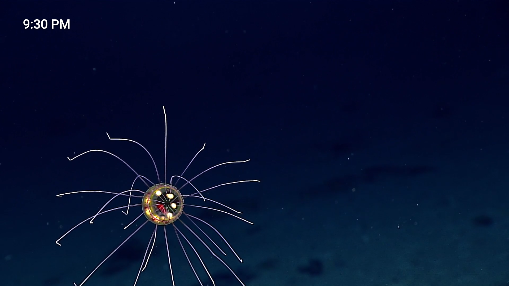 Clock on</td><td width="33%">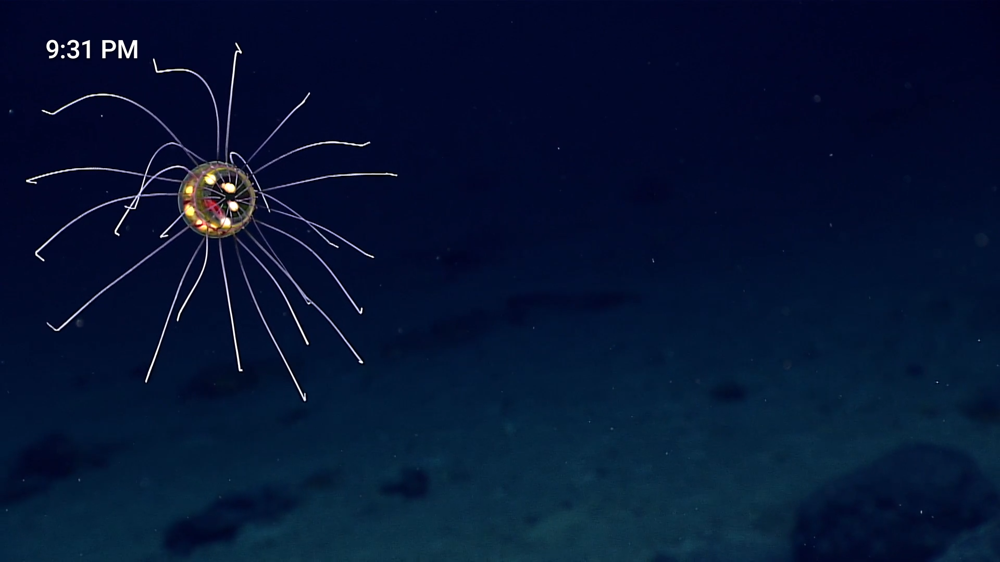 Clock later</td></tr>
<tr><td width="33%">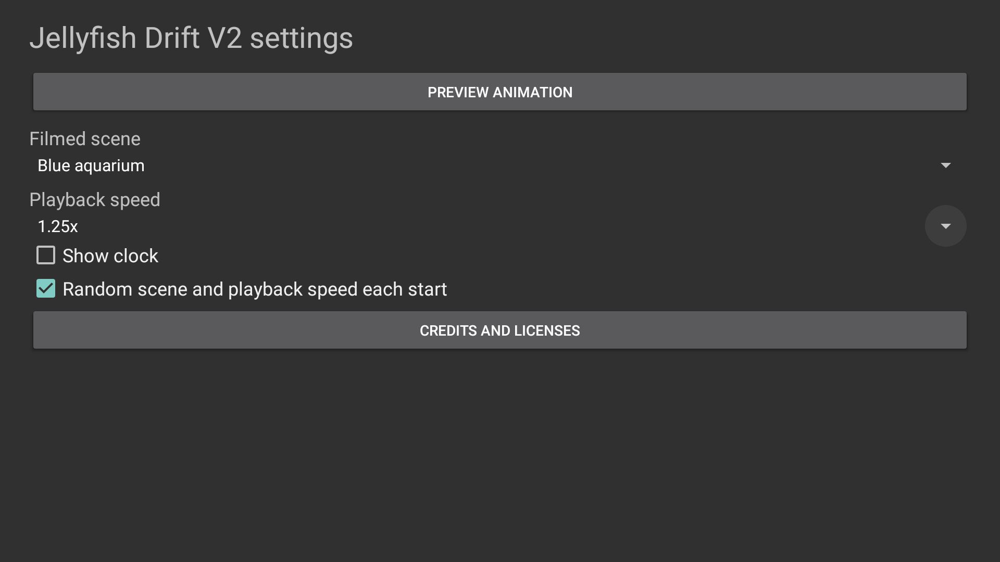 Settings</td><td width="33%">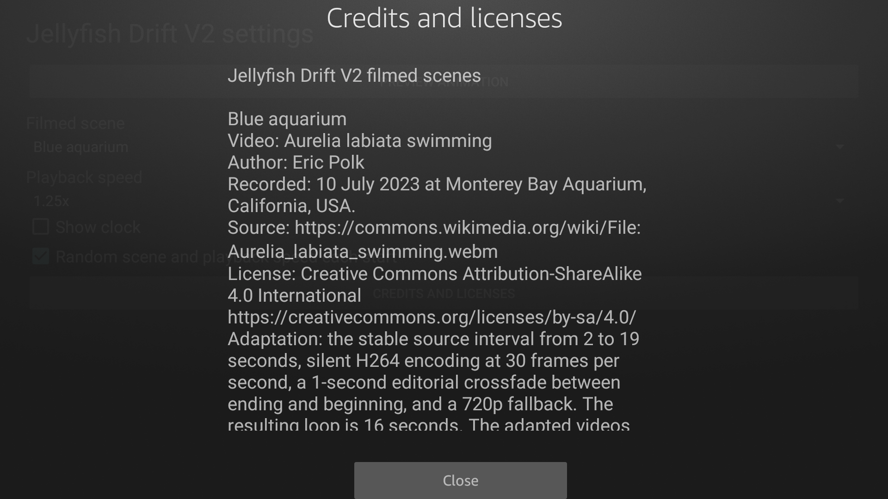 Credits</td><td width="33%">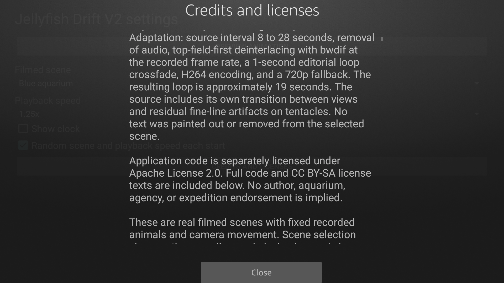 Licenses</td></tr>
</table>

Additional 2.0.0/code2 native captures from an Android TV API 34 emulator at 1920 x 1080, October 22, 2026 (Pacific). These show Settings and Preview, not an actual bound Dream or physical performance proof.

<table>
<tr><td width="33%">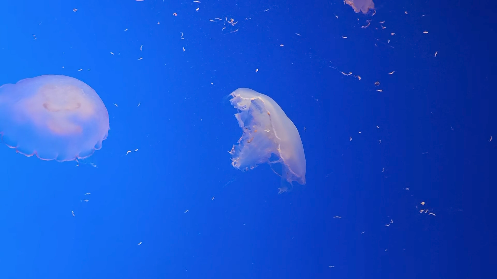 Clock off</td><td width="33%">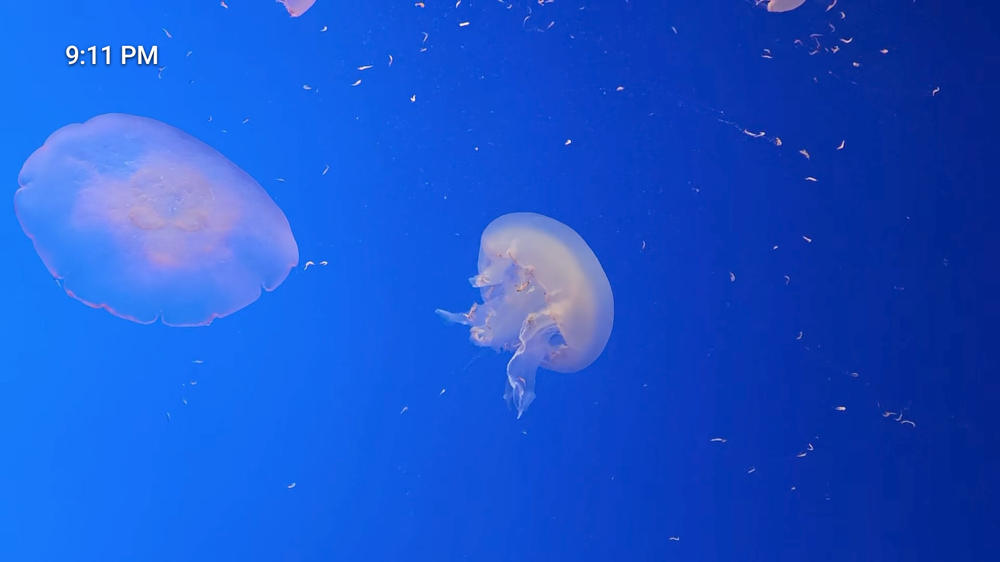 Clock on</td><td width="33%">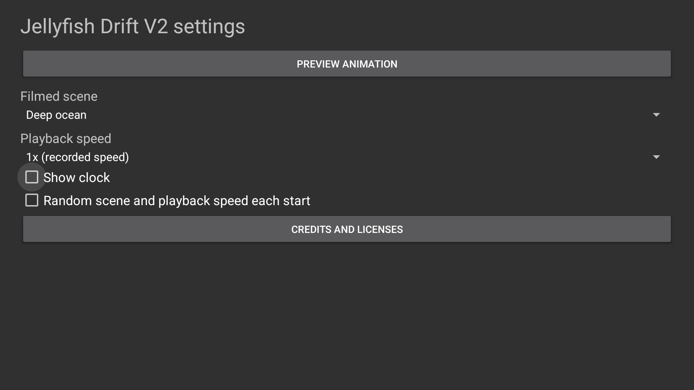 Settings</td></tr>
<tr><td width="33%">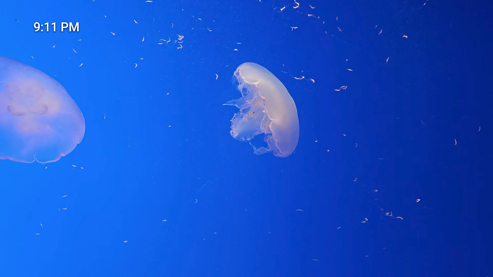 Clock later</td><td width="33%">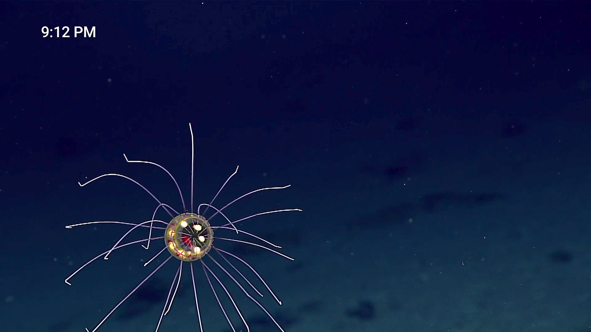 On, random</td><td width="33%">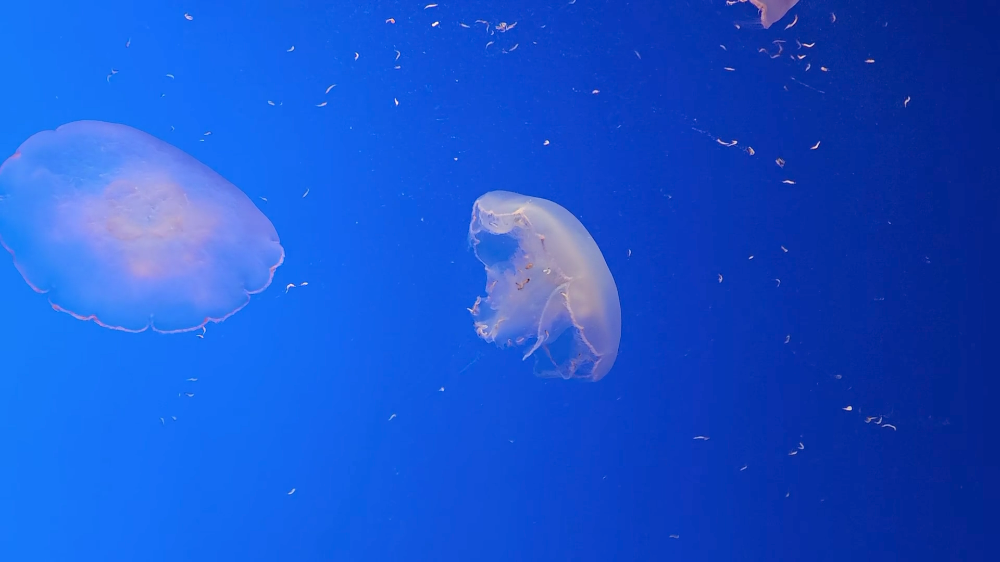 Off, random</td></tr>
<tr><td width="33%">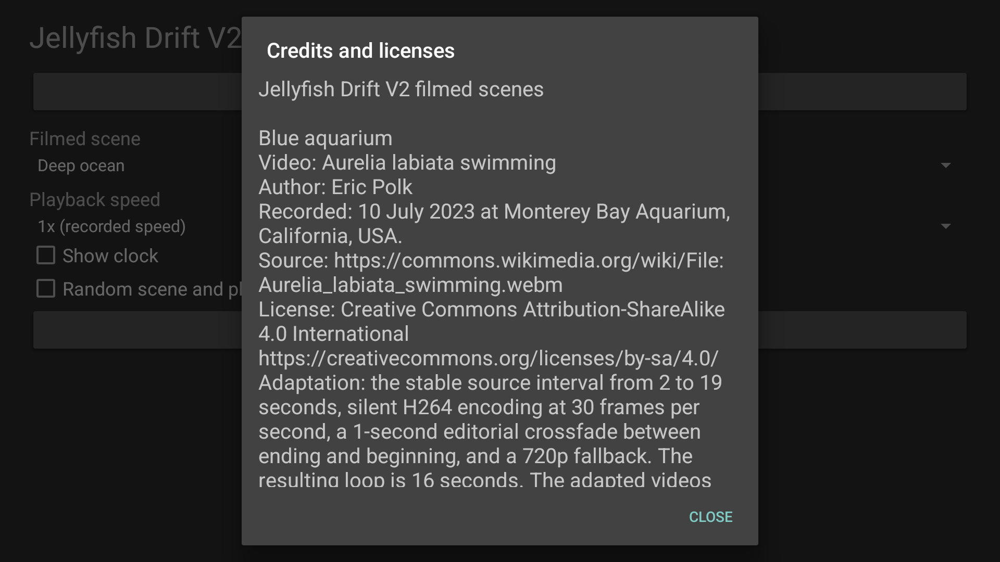 Credits</td><td width="33%">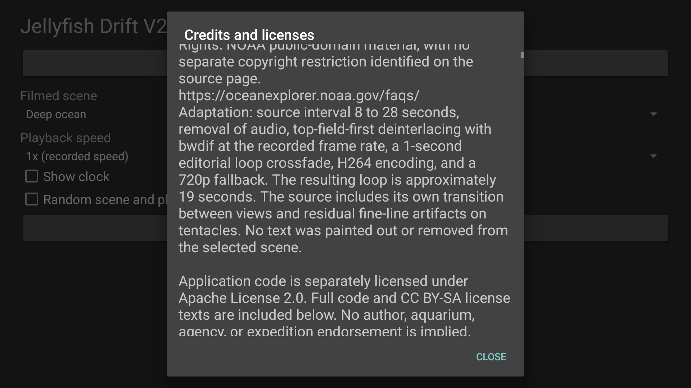 Licenses</td></tr>
</table>

[Image provenance and SHA-256 hashes](../art/screenshots/sources.json) identify the exact candidate. Clock on/off is selected with the native remote control. The paired clock images are 20 seconds apart; the clock keeps its saved choice during scene randomization.

Blue aquarium screenshots retain Eric Polk CC BY-SA 4.0 media terms. Deep ocean is credited NOAA public-domain source footage. See [source notices](../assets/NOTICE.txt).
