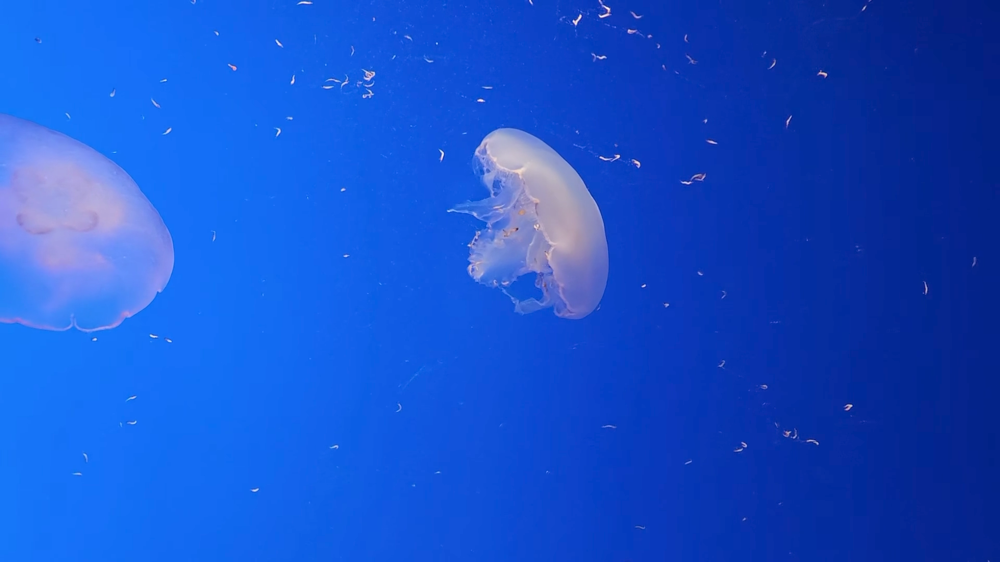
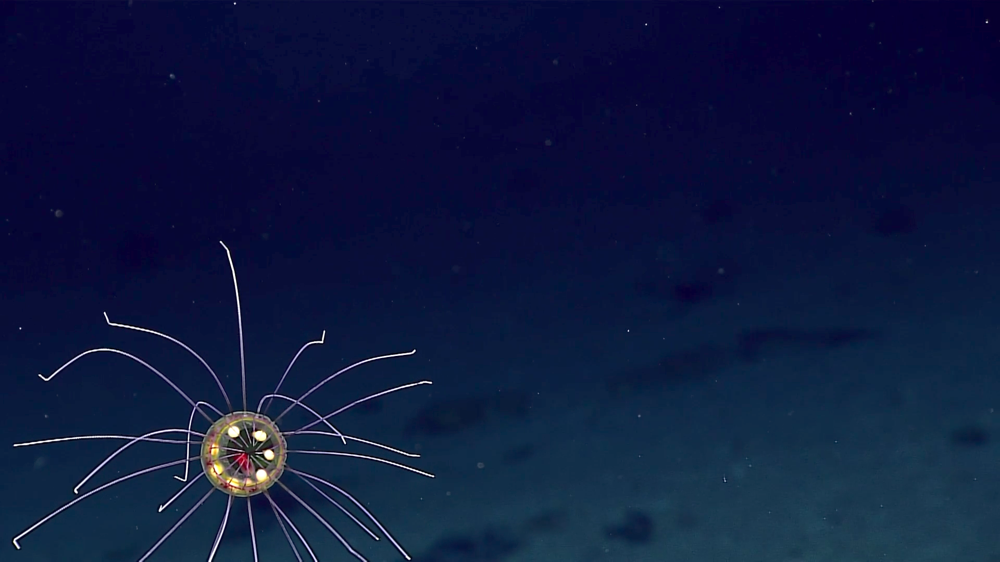
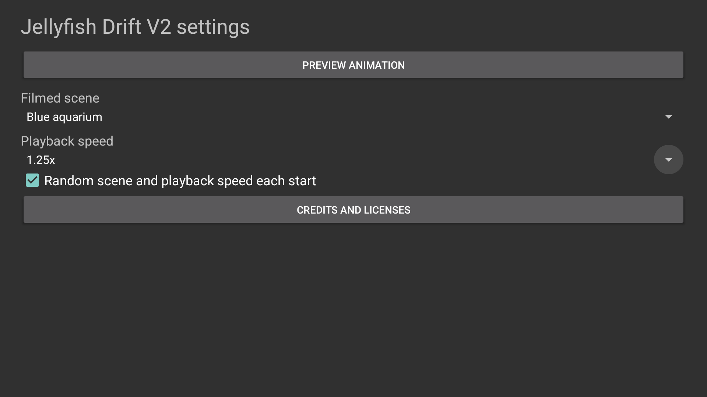
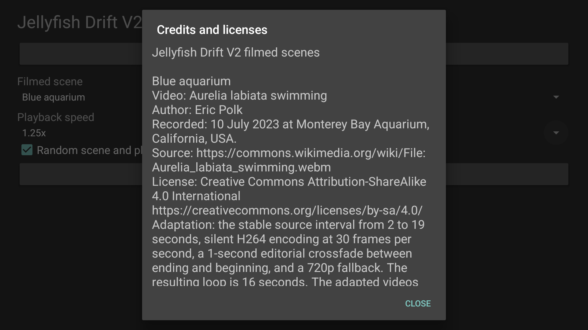
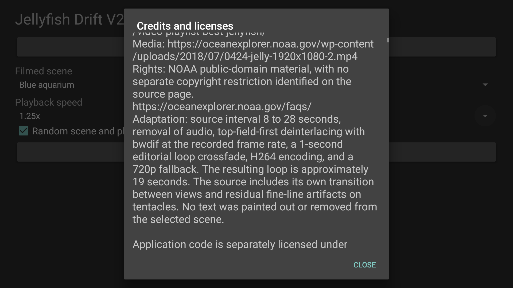

# Screenshots

Current 2.0.0/code1 native captures, Android TV API 34 emulator, 1920 x 1080, captured October 22, 2026 (Pacific). These show Settings and Preview. Actual bound Dream and physical device checks for this split package remain pending.

<table>
<tr><td width="33%"> Blue aquarium, recorded playback speed</td><td width="33%"> Deep ocean, recorded playback speed</td><td width="33%"> Three effective filmed controls</td></tr>
<tr><td width="33%"> Offline footage attribution</td><td width="33%"> Scrollable source notices</td></tr>
</table>

[Capture provenance and image hashes](../art/screenshots/sources.json) identify the exact candidate. No older-package image is presented as a capture of this candidate.

Blue aquarium footage: Eric Polk, CC BY-SA 4.0. Deep ocean footage: NOAA Ocean Exploration, public-domain source. Screenshots retain those media attribution and license terms; see [source notices](../assets/NOTICE.txt).
